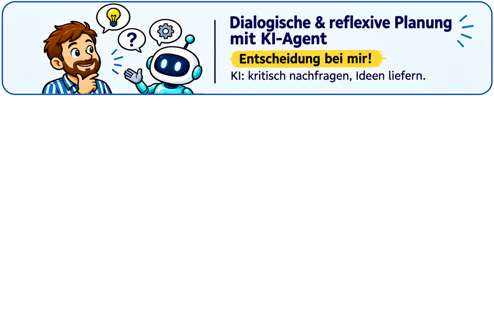
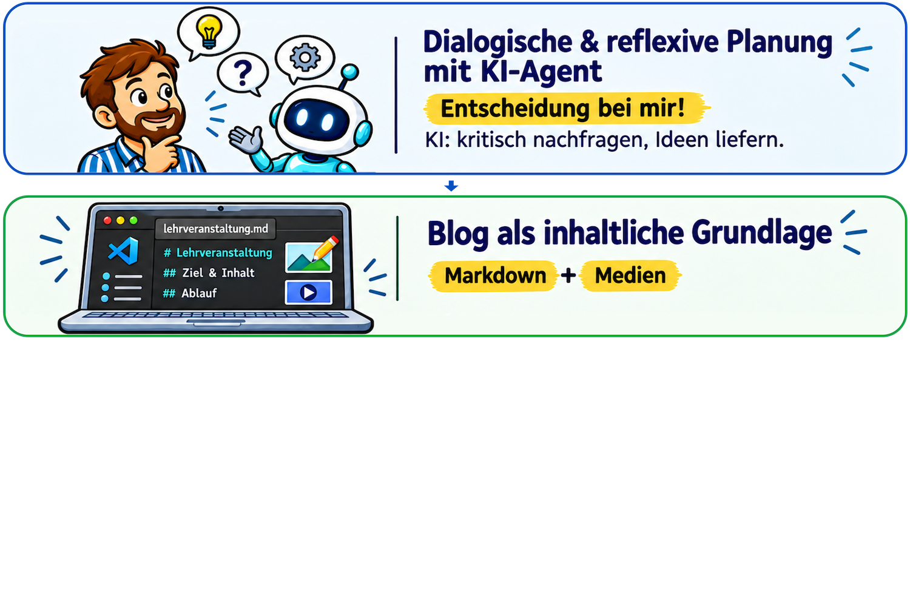
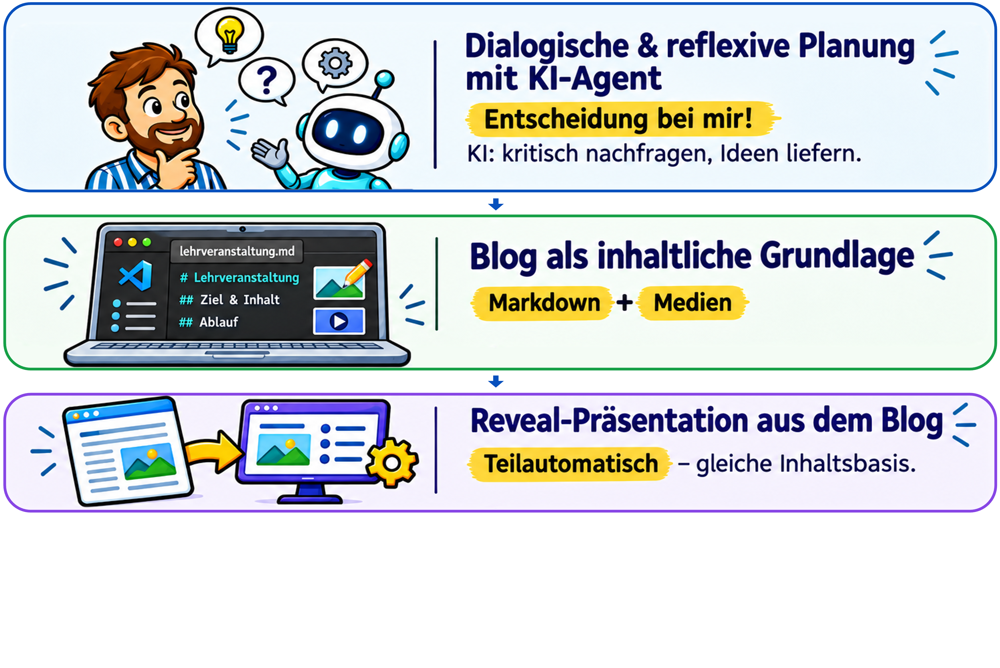



---

#### Ahhhhh!

<figure class="figure-frame figure-frame">
  
</figure>

Bildquelle: Eigene Darstellung (erstellt mit ChatGPT) · Lizenz: CC BY-SA 4.0

---

#### Mein neuer Workflow



  
  
  
  



Bildquelle: Eigene Darstellung (erstellt mit ChatGPT) · Lizenz: CC BY-SA 4.0

---

#### Das Ergebnis im Seminarraum

<figure class="figure-frame figure-frame">
  
</figure>

Bildquelle: Eigene Darstellung (erstellt mit ChatGPT) · Lizenz: CC BY-SA 4.0

---


