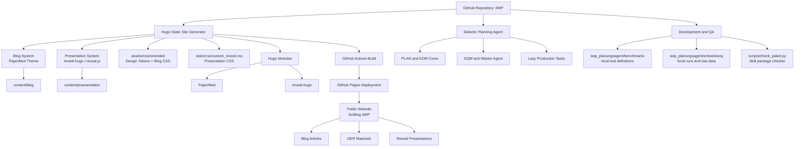

# AI Project Context – SciBlog iWIP

Scope: kompakter Systemueberblick ueber Repository, Architektur, Kerntechnologien und zentrale Dokumentation fuer AI-Agenten

Purpose: quick system overview for AI agents (Copilot, ChatGPT).

Project type:
Hugo static website + blog + presentation system + didactic planning agent.

Core technologies:
- Hugo static site generator
- PaperMod blog theme
- reveal-hugo / reveal.js for presentations
- GitHub Pages hosting
- GitHub Actions deployment

Content structure:
- content/blog → blog posts and OER materials
- content/praesentation → presentation versions of content
- content/impressum / datenschutz / hinweise → site pages

Agent structure:
- AGENTS.md → entry point for repository instructions
- .agents/skills/iwip-planungsagent/core/plan_core.md and kdm_core.md → process and dialog cores
- .agents/skills/iwip-planungsagent/core/master_agent.md and didaktisches_qualitaetsmodell_core.md → role and didactic quality core
- .agents/skills/iwip-planungsagent/SKILL.md → normal planning entry point
- templates, final checks, full DQM and external handoff → loaded only when required by PLAN-Core
- iwip_planungsagent/benchmarks/ → local, ignored manual regression definitions and expected fixtures
- iwip_planungsagent/entwicklung/ → local, ignored development history, benchmark runs and raw data; never normal runtime context
- iwip_planungsagent/publikation/ → local, ignored working copies for revisions of published content
- scripts/check_paket.py → versioned Skill package checker used by make qa-prompts

Styling architecture:
- assets/css/extended/00_design_tokens.css → design tokens
- assets/css/extended/10_custom.css → blog components
- assets/css/extended/20_custom_callouts.css → blog callouts
- static/css/custom_reveal.css → presentation styling

Architecture rules:
- modify existing CSS before creating new rules
- prefer Hugo / PaperMod / reveal solutions over custom CSS
- strict separation between blog CSS and reveal CSS
- no hardcoded colors outside design tokens

Documentation:
- project_governance/css_architecture.md → CSS system
- project_governance/repo_architecture.md → repository structure
- project_governance/content_emoji_policy.md → content emoji conventions
- project_governance/ai_editing_rules.md → AI editing rules

Goal of the project:
Open science blog publishing teaching materials as OER, supported by a
dialogical didactic planning agent.

System Context Diagram:

